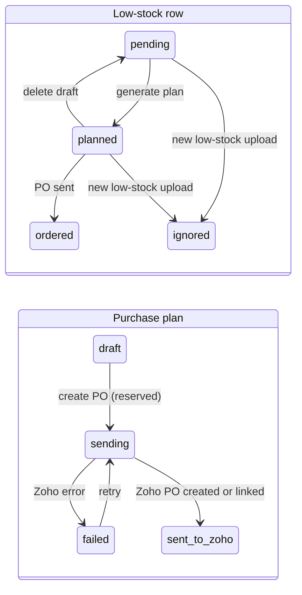
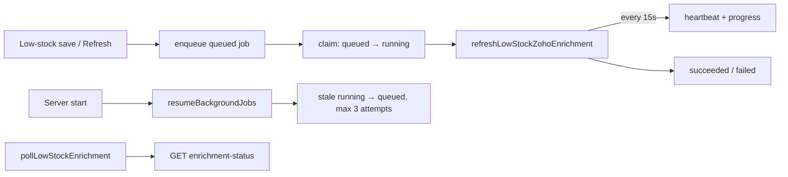

# Purchase Planning — Architecture & Process Guide

## Purpose

Purchase Planning turns **reported low-stock SKUs** into a **reviewed draft purchase order** in **Zoho Inventory**. It combines four data sources:

| Source | What it provides |
|--------|------------------|
| **Low-stock list** (CSV/XLSX upload) | Which SKUs need reordering |
| **Zoho Inventory** | Item names, active flag, Life Smile warehouse stock, 92-day direct sales, composite/bundle usage |
| **Vigil wholesale stock** (CSV/XLSX upload) | Available wholesale qty, used to cap order sizes |
| **All Prices** (user preferences) | Purchase unit prices at PO creation time |

Route: `/management/purchase-planning` (admin only), registered in `src/App.jsx`.

---

## File map

| Layer | Path | Role |
|-------|------|------|
| Routes | `backend/src/routes/purchasePlanning.js` | 14 endpoints, multer 5 MB uploads, `requireAuth` + `requireAdmin` |
| Controller | `backend/src/controllers/purchasePlanningController.js` | Validation, HTTP status mapping for error codes |
| Service | `backend/src/services/purchasePlanningService.js` | Business logic, schema bootstrap, Zoho calls |
| Jobs | `backend/src/services/purchasePlanningJobs.ts` | Durable background job store + runner (Postgres) |
| SKU matcher | `backend/src/utils/purchasePlanningSkuMatcher.js` | SKU normalisation, Zoho SKU → Vigil item code matching |
| UI | `src/pages/management/purchasePlanning/` | Page, six step components, table, badges, confirm dialog |
| Types | `src/pages/management/purchasePlanning/purchasePlanningTypes.ts` | Shared shapes for API responses and UI state |
| Utils | `src/pages/management/purchasePlanning/purchasePlanningUtils.ts` | Workflow state machine, pricing, enrichment polling |
| Tests | `backend/tests/purchasePlanning*.test.*`, `src/pages/management/purchasePlanning/*.test.*` | Service send flow, controller, jobs, matcher, UI workflow |

Tables, columns, constraints and indexes are created idempotently at startup by `ensurePurchasePlanningTables()` (called from `backend/src/db/index.js`). `backend/src/server.js` calls `resumeBackgroundJobs()` once the database is ready.

---

## Data model



### `purchase_low_stock_items`

- One row per SKU (unique on `sku`).
- Zoho enrichment: `item_name`, `zoho_item_id`, `zoho_item_active`, `current_zoho_stock`, `total_sales_last_3_months`, `total_bundle_usage_last_3_months`.
- Status: `pending` | `planned` | `ordered` | `ignored`.
- Vigil availability is not stored here; it is joined from the latest Vigil upload on read.

### `vigil_stock_uploads`

- Parsed rows stored as JSONB (`parsed_rows`).
- New plans use the latest upload and record it as `source_upload_id`.
- Each purchase cycle needs its own upload: `generate-plan` rejects the latest upload with `VIGIL_UPLOAD_STALE` when it is not newer than the last sent PO (`updated_at` of the newest `sent_to_zoho` plan). The UI applies the same rule via `getCurrentVigilUpload()`.

### `purchase_plans`

| Column | Notes |
|--------|-------|
| `plan_number` | e.g. `PP-20260529061215-MVVZ` |
| `status` | `draft` \| `reviewed` \| `sending` \| `sent_to_zoho` \| `failed` (`reviewed` is allowed by the constraint but not used) |
| `source_upload_id` | Vigil upload the plan was built from; draft refresh uses it |
| `purchase_order_number` | Unique among active plans (`uq_purchase_plans_active_po_number`) |
| `zoho_reference_number` | Stable Zoho reference for this plan, reused on every retry |
| `send_started_at` | Set when a send is reserved; used to detect interrupted sends |
| `zoho_purchase_order_id`, `zoho_error` | Result of the last send |

### `purchase_plan_items`

Snapshot per SKU at generation (or draft refresh): stock, sales, bundle usage, suggested/final qty, Vigil match, `included`, notes, optional `purchase_price`.

### `purchase_planning_jobs`

Durable background jobs (currently kind `low_stock_enrichment`). A partial unique index allows at most one `queued` and one `running` job per kind. Columns track status, attempts, heartbeat, progress, last error and summary.

---

## Workflow (six steps)

| Step | UI component | What happens |
|------|--------------|--------------|
| 1. Upload Vigil stock | `VigilUploadStep` | Required fresh every cycle: an upload older than the last sent PO no longer counts. Preview validates item code + stock columns; save requires zero invalid rows |
| 2. Upload low-stock SKUs | `LowStockUploadStep` | Saving replaces the current batch (confirm dialog), creates `pending` rows and queues enrichment |
| 3. Match & enrich from Zoho | `ZohoEnrichmentStep` | Background job matches SKUs, loads stock, sales and bundle usage; unmatched rows can be removed |
| 4. Generate draft plan | `GeneratePlanStep` | Readiness checklist; generation marks pending SKUs `planned` |
| 5. Review quantities & prices | `ReviewPlanStep` + `PurchasePlanTable` | Edit final qty (saves on blur/Enter), include/exclude lines, refresh from Zoho |
| 6. Create Zoho PO | `CreateZohoPoStep` | Enter PO number, confirm, send; shows sending/interrupted/sent states |

The step status machine lives in `computeWorkflow()` and the initial view in `getDefaultPurchasePlanningView()`; both are unit tested. Open plans (`draft`, `failed`, `sending`) take priority over the "latest sent PO" panel, except leftovers: a draft or failed plan created before the latest sent PO is never auto-loaded or counted as the open plan (it stays in Recent plans to open or delete). With no pending batch and no current open plan, the page opens on Step 2 with the latest sent PO panel shown.

Destructive or expensive actions (replace batch, remove SKU, delete draft, refresh Zoho data, create PO) use the in-page confirm dialog from `useConfirmDialog.tsx`. There are no `window.confirm` prompts.

---

## Sending a PO safely

`createZohoPurchaseOrderForPlan` is built so a retry, double click, timeout or server crash never creates a second Zoho PO:

1. **Validate outside the lock.** Load the plan and selected lines, and check that every selected Zoho item is still active (inactive items are flagged on the plan and the send is refused with `ZOHO_ITEMS_INACTIVE`).
2. **Reserve in a transaction.** Lock the plan row, re-check that it is eligible and unchanged, then set `status = 'sending'`, `send_started_at`, the PO number and the stable `zoho_reference_number`. A concurrent send gets `PO_SEND_IN_PROGRESS`; a PO number used by another active plan gets `PO_NUMBER_IN_USE`.
3. **Look before creating.** Search Zoho for a PO with the same number and reference. If one exists it is **linked** (`reconciled: true`) instead of created.
4. **Create once.** The Zoho POST runs with `noTransportRetry`, so the client never blindly re-posts after a network error.
5. **Finalize.** On success the plan becomes `sent_to_zoho` and its SKUs `ordered`. On a Zoho error the plan becomes `failed` with `zoho_error` and can be retried from Step 6.

A send still marked `sending` after 10 minutes (`PO_SEND_STALE_MS`) is treated as interrupted. Step 6 then offers **Check Zoho & finish**, which repeats the lookup-then-create path.

### Zoho payload rules

- Never send app names or internal branding to Zoho (notes, reference, line descriptions, headers). Leave `notes` empty unless the user supplies business text.
- All calls go through `zohoApiRequest` with the neutral User-Agent; do not raise the shared Zoho request budget.

---

## Background enrichment jobs



- Jobs are stored in Postgres, so status survives restarts and is shared across instances.
- A running job heartbeats every 15 s; one without a heartbeat for 60 s is stale and is requeued (up to 3 attempts), otherwise marked failed.
- A run times out after 20 minutes.
- Enrichment only updates `pending` rows, so SKUs already on a plan are never changed by it.
- The UI polls every 2.5 s and shows "Resumed after a server restart" when the job is on a later attempt.

---

## Quantity calculation

`calculatePlanQuantities` in `purchasePlanningService.js`:

```
totalUsage   = totalSalesLast3Months + totalBundleUsageLast3Months
suggestedQty = ceil(totalUsage)
finalQty     = min(suggestedQty, vigilWholesaleAvailable)
included     = finalQty > 0 AND Vigil matched AND wholesale > 0
```

Automatic notes: no Vigil match, Vigil qty 0, or Vigil stock below required usage (final qty capped).

Bundle usage comes from the active Zoho composite catalog intersected with 92-day sales (MIX/SET/KIT/COMBO/BUNDLE SKU names as a fallback). Composite BOMs are fetched with cached, concurrent lookups and rolled back to component SKUs.

**Draft refresh** (`POST /plans/:id/refresh-zoho-data`) re-pulls Zoho data and recalculates every line, which can overwrite manual quantity edits. Wholesale availability comes from the plan's own `source_upload_id`; if that upload was deleted the latest upload is used and the response reports `vigilSource: 'latest_fallback'`.

---

## SKU matching

`purchasePlanningSkuMatcher.js` normalises SKUs (uppercase, trim, unified dashes/spaces) and indexes Vigil rows by exact and parent variants (e.g. `LIFEP5-16-GREEN` → `LIFEP5-16`). Match types: `exact` | `parent` | `not_found`. Zoho items are matched against item code, name and part-number variants from the warehouse-scoped item list.

---

## API reference

All routes are under `/api/purchase-planning`, require an admin session, and the client uses a 120 s timeout (`PURCHASE_PLANNING_TIMEOUT_MS`).

| Method | Path | Purpose |
|--------|------|---------|
| GET | `/low-stock` | Pending low-stock SKUs with Vigil joined |
| GET | `/low-stock/enrichment-status` | Job state: running, progress, attempts, lastError, lastSummary |
| DELETE | `/low-stock/:id` | Remove a pending SKU from the batch |
| POST | `/low-stock-upload` | Preview, or save with `?save=true` |
| POST | `/low-stock/refresh-zoho` | Queue an enrichment job |
| POST | `/vigil-upload` | Preview, or save with `save=true` |
| GET | `/vigil-uploads` | Recent Vigil uploads |
| POST | `/generate-plan` | Create a draft from pending SKUs |
| GET | `/plans` | Recent plans with line counts and totals |
| GET | `/plans/:id` | Plan with items |
| POST | `/plans/:id/refresh-zoho-data` | Re-enrich an open plan |
| DELETE | `/plans/:id` | Delete a draft; planned SKUs return to pending (`restoredSkuCount`) |
| PUT | `/plans/:id/items/:itemId` | Patch `finalQty`, `included`, `purchasePrice`, `notes` |
| POST | `/plans/:id/create-zoho-po` | Send or reconcile the Zoho PO |

### Error codes

| HTTP | Codes |
|------|-------|
| 400 | `NO_VIGIL_UPLOAD`, `VIGIL_UPLOAD_STALE`, `NO_LOW_STOCK_ITEMS`, `LOW_STOCK_ZOHO_MATCH_INCOMPLETE`, `NO_PO_LINES`, `ZOHO_PO_NUMBER_REQUIRED`, `ZOHO_PO_PRICE_REQUIRED`, `ZOHO_VENDOR_NOT_CONFIGURED`, `PLAN_NOT_DRAFT`, `PLAN_HAS_NO_ITEMS`, `INVALID_*`, parse errors |
| 404 | `PLAN_NOT_FOUND`, `PLAN_ITEM_NOT_FOUND`, `LOW_STOCK_ITEM_NOT_FOUND` |
| 409 | `ENRICHMENT_RUNNING`, `PLAN_NOT_EDITABLE`, `DUPLICATE_PO`, `LOW_STOCK_ITEM_NOT_REMOVABLE`, `ZOHO_ITEMS_INACTIVE`, `PO_SEND_IN_PROGRESS`, `PO_NUMBER_IN_USE`, `ZOHO_PO_NUMBER_TAKEN`, `PLAN_CHANGED_DURING_SEND` |
| 503 | `ZOHO_NOT_CONFIGURED` |

---

## Configuration

| Variable | Purpose |
|----------|---------|
| `PURCHASE_PLANNING_WAREHOUSE_ID` / `LIFE_SMILE_WAREHOUSE_ID` | Zoho warehouse for stock lookup |
| `PURCHASE_PLANNING_WAREHOUSE_NAME` | Default `LIFE SMILE`, resolved via the warehouses API when no ID is set |
| `ZOHO_PURCHASE_VENDOR_ID` | PO vendor (preferred) |
| `PURCHASE_PLANNING_REPORT_GROUP` | Fallback vendor from the weekly report config |
| Standard Zoho OAuth vars | See `docs/integrations-zoho.md` |

---

## Known limitations

- Purchase prices come from the user's All Prices preferences, not a server-side catalogue.
- Generate and draft refresh do synchronous Zoho work; very large batches can approach proxy timeouts (the client allows 120 s).
- `reviewed` plan status exists in the schema but nothing sets it.

---

## Admin cheat sheet

1. Upload the **Vigil stock** file and save.
2. Upload the **low-stock SKUs** and save; wait for enrichment to finish (it keeps running if you leave the page).
3. Remove or fix any unmatched SKUs, then **Generate Draft Purchase Plan**.
4. Review final quantities and check prices from All Prices.
5. Enter the PO number and **Create Draft PO in Zoho**. If a send is interrupted, open the plan and use **Check Zoho & finish** — it will not create a duplicate.
